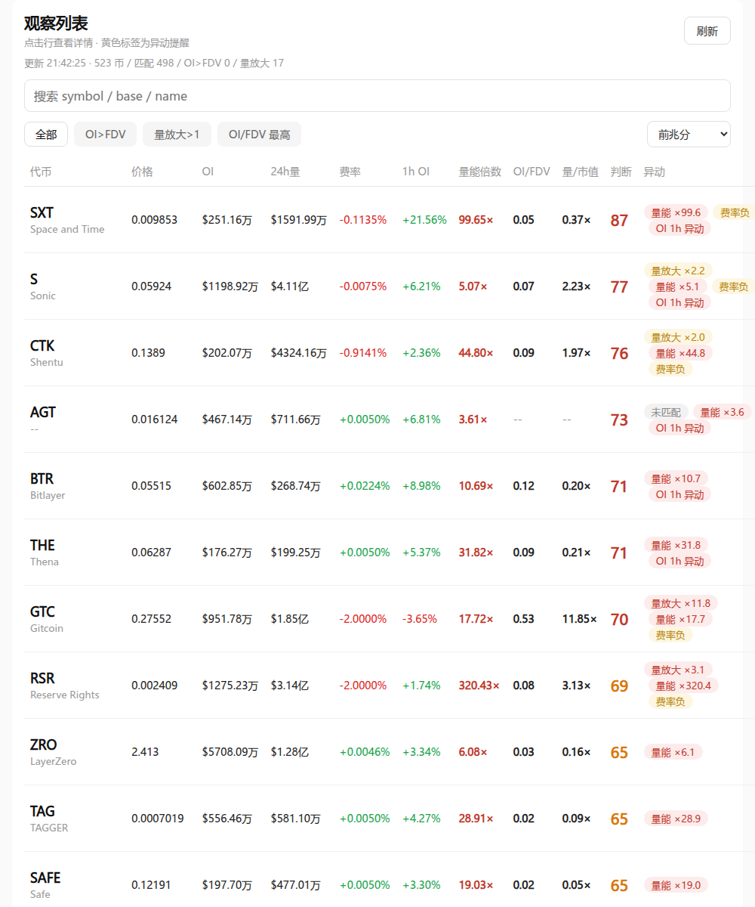

# Binance OI Monitor · 币安合约 OI 观察列表

扫币安 USDⓈ-M **永续合约**的持仓量（OI）与成交额，算出「**OI÷FDV**」「**成交量÷市值**」，
并给每个币打一个**前兆评分**，最后用一个单文件网页（手机优先、浅色表格）展示。

- 只依赖 **Python 标准库**，无第三方包、无前端依赖、零 CDN。
- **不建数据库**：只落一个明文 `oi_scan.json`。
- 数据全部来自公开接口，**不需要任何 API Key**。



## 看什么

| 列 | 含义 |
|---|---|
| 价格 / 24h量 | 币安永续的标记价与 24 小时成交额（美元） |
| **OI** | 未平仓合约的**美元名义**价值（`futures/data/openInterestHist` 的 `sumOpenInterestValue`） |
| 费率 | 资金费率（`fapi/v1/premiumIndex` 的 `lastFundingRate`） |
| 1h OI | 近 1 小时持仓变化 |
| **量能倍数** | 最近 1 小时成交额 ÷ 之前 72 小时成交额的中位数 |
| **OI/FDV** | 持仓名义 ÷ 完全稀释估值（>1 = 杠杆叠得比总估值还厚） |
| 量/市值 | 24h 成交额 ÷ 市值（换手倍数） |
| **判断** | 前兆评分（见下），≥70 红 / ≥55 橙 / ≥40 黄 / 其余灰 |

点任意一行才展开详细：四个分项各自得分 + 权重依据 + 原始字段。

## 前兆评分怎么来的

`评分 = 量能倍数 35% + 1h OI 30% + 费率 20% + OI÷FDV 15%`

前 35/30/20 这三项的**权重不是拍的**，来自本仓库 `pump_study.py` 的真实回测
（198 个币安永续、84,483 小时）：

| 信号（事件前 1 小时） | 1h 涨≥5% 前的命中率 | 全样本基础率 | lift |
|---|---|---|---|
| 量能 ≥ 平时 3 倍 | 49.3% | 10.2% | **4.8×** |
| OI 涨 ≥ 2% | 29.9% | 7.4% | **4.1×** |
| 费率为负 | 28.7% | 12.4% | **2.3×** |
| 价没动、OI 先涨 | 5.8% | 3.4% | 1.7× |
| （1h 涨 ≥8% 时）量能 ≥3 倍 | 58.1% | 10.2% | **5.7×** |
| （1h 涨 ≥8% 时）价没动、OI 先涨 | 3.6% | 3.4% | **1.05×（等于随机）** |

最后一行是这套东西的价值所在：**「价格没动、OI 先涨」这个流传很广的埋伏信号，在大涨样本里等于瞎猜**；
真正有区分度的是**量能放大**、**OI 在涨**（不要求价格不动）和**费率转负**。
剩下那 15% 的 `OI÷FDV` 是**结构性判断，没有回测**（页面上也这么标）。

## 跑起来

```bash
# 1) 扫一轮，写出 oi_scan.json（约 45 秒，523 个币）
python3 oi_scan.py

# 2) 起网页（默认 0.0.0.0:8768）
python3 oi_web.py
# 打开 http://127.0.0.1:8768
```

环境变量（都可选，给的是默认值）：

| 变量 | 默认 | 作用 |
|---|---|---|
| `OI_DIR` | `/home/tou/.hermes/oi_monitor` | 数据/日志目录 |
| `OI_SCAN_JSON` | `<OI_DIR>/oi_scan.json` | 前端读的数据文件 |
| `OI_SCAN_SCRIPT` | `/home/tou/.hermes/scripts/oi_scan.py` | 「刷新」按钮要起的脚本 |
| `OI_PAGE` | `<同目录>/oi_page.html` | 前端页面文件 |
| `OI_PORT` | `8768` | 监听端口 |

定时扫描（每 5 分钟）：

```bash
*/5 * * * * cd /path/to/repo && /usr/bin/python3 oi_scan.py >/dev/null 2>&1
```

## 回测脚本

```bash
python3 pump_study.py     # → <OI_DIR>/pump_study.json
```

它会拉 200 个币的 **1h K 线 + 1h OI 历史 + 资金费率**，统计「暴涨前一小时」各信号的条件频率
（hit_rate / base / lift），并打印一张可读表。

## 已知限制（请务必读完）

- **币安 OI 历史只保留最近约 30 天**：`openInterestHist` 用 `period=1d` 只给 30 个点，用 `period=1h` 给 500 个点
  （≈21 天）。所以 OI 类信号只能在很短的时间窗里回测，**换个市场阶段结论可能完全不同**。
- 回测统计的是**条件频率**，不是收益回测：没有扣手续费/滑点，也不代表你能在信号出现时买到。
- **符号撞名**：币安有股票/指数类合约（`underlyingType` 为 `EQUITY/INDEX/...`，如 `NVDAUSDT`）。
  这些没有 FDV，若按 symbol 去 CoinGecko 匹配会撞上同名小币，算出天文数字的 OI/FDV。
  本项目用 `underlyingType == "COIN"` + `contractType == "PERPETUAL"` 把它们剔掉。
- **缺失一律显示 `--` 并置灰**，绝不当成 0、也绝不当成「安全」。没匹配上市值 ≠ 数据为 0。
- 评分只表示**异动/前兆强度**，**不代表涨跌方向**，更不是买入建议。
- 网络：抓币安/CoinGecko 的机器需要能直连或走代理；本项目不自带代理，请自行设置
  （脚本用 `http.client` + `set_tunnel`，需要代理时改 `PROXY` 常量）。

## 文件

```
oi_scan.py      # 扫描：币安行情 + 逐币 OI + 1h 量能倍数 + CoinGecko 市值/FDV → oi_scan.json
oi_web.py       # 后端：http.server，读 oi_page.html 和数据 JSON，提供 /api/scan、/api/refresh
oi_page.html    # 前端：单文件、内联 CSS/JS、手机优先、浅色表格
pump_study.py   # 回测：验证「暴涨前」各信号的真实 lift
```

## 许可

MIT
